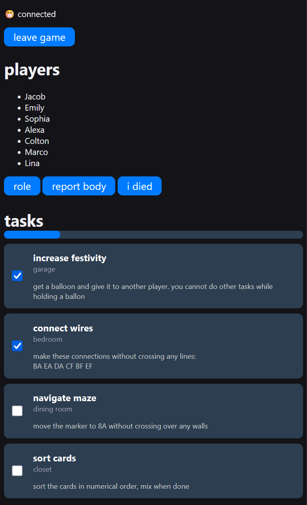

# Among Us In Real Life

This is a web application made with Node.js that allows you to play Among Us in real life.

## Features
- Host and Player UI
- Task System
- Sabotage System
- Emergency Meetings
- Voting
- Death Tracking
- Roles!
  
You can configure tasks, sabotages, roles, and various settings easily using JSON files.

## Main UI

## Setup

- Download Node.js [here](https://nodejs.org/) if you haven't already.
- Run `npm install` once, and `npm start` every time you want to start up your server.
- To connect to the server, you can go to `localhost:3000`.
- Everyone else should should type in your computer's local ip address.

## Starting the Game
- To start the game, someone has to connect as the host. To do this, simply put "host" as your name.
  - Any device can be the host, but usually the computer running the program is the host.
- Once everyone has joined, the host can press the "Start Game" button to begin the game.

## Configuration
- Before starting a game, you should probably configure the tasks, sabotages, roles, and settings.
- A detailed guide on how to do this can be found [here](https://github.com/blue908/among-us-in-real-life/wiki/Configuring-Settings).

## Roles

Unlike Among Us, there are neutral roles. The good and evil roles work similarly to crewmates and imposters in Among Us, but the neutral team is a special team that have their own objective.

Currently, there are three hard-coded properties that a role can have.

- ### Silencer
  - Can select any player to be silenced for the next meeting
  
- ### Jester
  - Wins if they get voted out
  
- ### Executioner
  - Wins if their target gets voted out

None of these properties are tied to a certain team and you can mix and match them however you want. Additionally, roles do *not* have to based on them. There are many interesting roles that have nothing to do with these properties.

## Wiki

There is a lot more information about this project in [the wiki](https://github.com/blue908/among-us-in-real-life/wiki).
